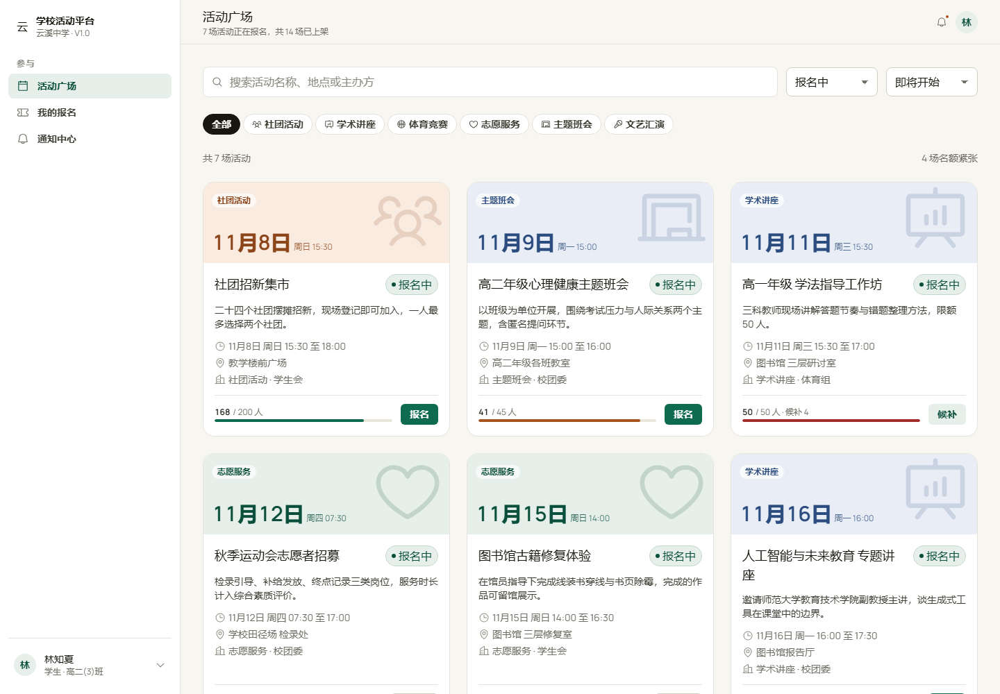

# 学校活动在线服务平台 V1.0

[](https://github.com/Yqzxwjn/school-activity-platform/actions/workflows/test.yml)

一套可以直接部署使用的校园活动管理系统：活动发布 → 审核上架 → 在线报名 → 名额候补 → 签到码核销 → 数据统计。服务端带真实数据库、账号体系与权限校验，不再依赖浏览器本地存储。

- 仓库：<https://github.com/Yqzxwjn/school-activity-platform>
- 服务端：Node.js 22.5+，使用 Node 内置 SQLite（`node:sqlite`），**零第三方依赖**，不需要安装数据库服务。
- 前端：原生 HTML / CSS / JavaScript，无框架、无构建步骤，由服务端直接托管。
- 已通过 10 项接口集成测试，覆盖登录、报名、候补、核销、审核与权限边界。



## 快速开始

```bash
# 需要 Node.js 22.5 及以上（node:sqlite 内置）
node --version

npm start
# 打开 http://localhost:3000
```

首次启动会自动创建数据库并写入一套完整的学校演示数据：325 个账号、17 场活动、1670 条报名。

| 角色 | 姓名 | 账号 | 初始密码 |
| --- | --- | --- | --- |
| 管理员 | 陈立行 | `A2015001` | `xbh2026` |
| 活动组织者 | 周予安 | `T2018046` | `xbh2026` |
| 活动组织者 | 邵明远 | `T2017022` | `xbh2026` |
| 活动组织者 | 林雪见 | `T2020041` | `xbh2026` |
| 学生 | 林知夏 | `20240312` | `xbh2026` |

其余学生账号为 `20250001` 起，密码相同。登录后可在左下角账号菜单修改密码；管理员可以在「用户管理」里新建账号、重置密码、停用账号。

> 生产环境请在首次启动前设置 `SEED_PASSWORD`，或启动后立即修改管理员密码。

## 功能

**学生与教师**

- 活动广场：搜索、分类筛选、状态筛选、按时间或热度排序、名额紧张提示。
- 活动详情：介绍、议程、报名须知、主办方、名额进度、报名倒计时。
- 在线报名：表单校验；名额已满自动进入候补；报名成功展示 6 位签到码。
- 我的报名：按状态查看、签到码、取消报名（名额自动递补给候补第一位）。
- 通知中心：报名成功、候补递补、审核结果、活动提醒。

**活动组织者**

- 我的活动：按状态筛选、报名与候补统计、编辑与提交审核。
- 发布活动：名称、分类、时间、地点、对象、名额、议程、须知；时间与名额校验；同场地时间冲突提示；草稿与提交审核。
- 报名名单：搜索筛选、逐条核销 / 撤销、复制签到码、导出 CSV。
- 签到核销：输入 6 位签到码自动提交，重复核销与候补拦截，实时签到率与核销流水。

**管理员**

- 活动审核：待审核 / 已通过 / 已驳回，场地冲突提示，驳回必须填写理由并通知组织者。
- 用户管理：新建账号、搜索筛选、启停账号、重置密码。
- 数据统计：活动数、报名人次、平均签到率、待审核；近 6 个月趋势、年级分布、分类对比、热门排行；导出 CSV。

## 部署

### Docker（推荐）

```bash
docker compose up -d --build
# 数据保存在 activity-data 卷中
```

或：

```bash
docker build -t school-activity .
docker run -d --name school-activity -p 3000:3000 \
  -v activity-data:/app/data \
  -e SEED_PASSWORD='换成你的初始密码' \
  school-activity
```

### 直接运行

```bash
PORT=8080 DB_PATH=/var/lib/school-activity/app.db npm start
```

### 环境变量

| 变量 | 默认值 | 说明 |
| --- | --- | --- |
| `PORT` | `3000` | 监听端口 |
| `HOST` | `0.0.0.0` | 监听地址 |
| `DB_PATH` | `data/app.db` | SQLite 数据库文件位置 |
| `SEED_PASSWORD` | `xbh2026` | 初始化账号的密码 |
| `SEED` | `true` | 设为 `false` 时，空数据库不再自动写入演示数据 |
| `LOG` | 开启 | 设为 `off` 关闭请求日志 |

### 反向代理与 HTTPS

建议用 Nginx / Caddy 反向代理到 `127.0.0.1:3000` 并配置 HTTPS。登录 Cookie 为 `HttpOnly + SameSite=Lax`，当请求头带有 `X-Forwarded-Proto: https` 时会自动加上 `Secure`。

```nginx
server {
  listen 443 ssl;
  server_name activity.example.edu.cn;

  location / {
    proxy_pass http://127.0.0.1:3000;
    proxy_set_header Host $host;
    proxy_set_header X-Forwarded-For $proxy_add_x_forwarded_for;
    proxy_set_header X-Forwarded-Proto $scheme;
  }
}
```

### 备份与恢复

数据全部在 `data/app.db`（连同 `-wal`、`-shm` 文件）。建议每天停写或使用 `sqlite3 app.db ".backup backup.db"` 备份，保留最近 30 天。恢复时停止服务，替换数据库文件后启动。

### 重置演示数据

```bash
npm run seed     # 清空现有数据并重新写入演示数据
```

## 架构

```
浏览器（原生 JS 单页应用）
   │  JSON over HTTP（同源 Cookie 会话）
   ▼
server.js                 静态资源 + HTTP 入口
server/api.js             路由表、鉴权、CSRF 同源校验
server/services.js        业务规则：报名、候补、核销、审核、统计
server/db.js              SQLite 连接、表结构、行映射
server/auth.js            scrypt 密码散列、会话、登录限流
server/http.js            JSON、Cookie、静态文件
server/seed-data.json     首次启动写入的演示数据
public/                   前端页面与资源
```

- 数据表：`users`、`activities`、`registrations`、`notices`、`sessions`、`meta`。
- 报名在事务中完成：检查重复与名额，按情况写入 `confirmed` 或 `waitlist`。
- 取消报名时，如果释放的是正式名额，事务内把候补队列第一位转为 `confirmed` 并写入通知。
- 签到码为 6 位数字，同一活动内唯一；核销会记录时间，重复核销返回 409。
- 密码使用 scrypt（N=16384）加盐散列；会话令牌存哈希，7 天过期；同一 IP + 账号 10 分钟内失败 8 次会被限流。
- 所有写操作校验同源（Origin），角色权限在路由层与业务层各校验一次。

### 主要接口

| 方法 | 路径 | 说明 |
| --- | --- | --- |
| POST | `/api/auth/login` | 登录 |
| POST | `/api/auth/logout` | 退出 |
| GET | `/api/auth/me` | 当前账号 |
| POST | `/api/auth/password` | 修改自己的密码 |
| GET | `/api/bootstrap` | 工作台初始化数据 |
| POST | `/api/activities` | 新建或修改活动（组织者 / 管理员） |
| POST | `/api/activities/:id/submit` | 提交审核 |
| POST | `/api/activities/:id/review` | 审核（管理员） |
| DELETE | `/api/activities/:id` | 删除活动 |
| POST | `/api/activities/:id/registrations` | 报名 / 候补 |
| DELETE | `/api/registrations/:id` | 取消报名 |
| GET | `/api/activities/:id/roster` | 报名名单 |
| POST | `/api/activities/:id/checkin` | 按签到码核销 |
| POST / DELETE | `/api/registrations/:id/checkin` | 手动核销 / 撤销核销 |
| GET | `/api/notices` | 通知列表 |
| POST | `/api/notices/read` | 标记已读 |
| GET / POST | `/api/users` | 账号列表 / 新建账号（管理员） |
| PATCH | `/api/users/:id` | 修改账号（管理员） |
| POST | `/api/users/:id/password` | 重置密码（管理员） |
| GET | `/api/stats` | 全校统计（管理员） |
| GET | `/api/health` | 健康检查 |

## 测试

```bash
npm test
```

测试会以独立端口与临时数据库启动真实服务进程，覆盖：

1. 未登录访问被拒绝
2. 密码错误与正确登录
3. 学生能看到活动与自己已有的报名
4. 报名、重复报名拒绝、取消报名
5. 满员进入候补
6. 学生越权发布活动与查看名单被拒绝
7. 组织者发布 → 提交审核 → 管理员通过
8. 组织者核销签到码、重复核销拒绝、撤销核销
9. 管理员新建账号并用新账号登录
10. 管理员统计接口返回完整指标

## 目录结构

```
SchoolActivity/
├── server.js               服务入口
├── package.json            脚本与运行要求（无依赖）
├── Dockerfile              容器镜像
├── docker-compose.yml      一键部署
├── server/                 数据层、认证、业务、路由、种子数据
├── public/                 前端页面与静态资源
│   ├── index.html          官网首页
│   ├── login.html          登录
│   ├── app.html            工作台
│   ├── privacy.html / terms.html / 404.html
│   └── assets/             样式、脚本、字体、图标
├── tests/api.test.js       接口集成测试
├── screenshots/            界面截图
└── docs/                   源代码说明、页面与功能对照
```

## 说明与限制

- 单机 SQLite 适合一所学校（数千学生、每年数万报名）。如要多校区或高并发，可把 `server/db.js` 的访问层替换为 PostgreSQL / MySQL。
- 未包含短信与邮件通知、二维码扫描、附件上传；签到使用 6 位数字码。
- 账号由管理员创建，未对接学校统一身份认证（LDAP / CAS / 企业微信）；接口层已抽象，可按需接入。
- 软件说明书如要求 PHP 7.4 + MySQL 部署，可按当前表结构与接口平移到 PHP；当前实现以 Node.js 交付，是为了让平台可以零依赖直接运行。

## 许可

- 图标：[Phosphor Icons](https://phosphoricons.com)，MIT License。
- 字体：Manrope、JetBrains Mono，SIL Open Font License。
- 其余代码为本次开发成果。
